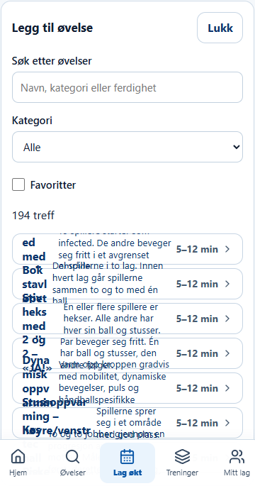
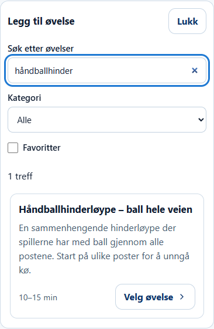

# Håndballtrener’n 3.0.1 – mobilrettinger og spillerimport

Kontrollert 18. november 2026. Videreutvikling av eksisterende 3.0; øvelsesbanken og lagringsformatets eksisterende data er bevart. Versjonen kommer fra `package.json`, og produksjonsbygget bekrefter samme verdi i appkoden og `dist/version.json`.

## Mobilrettinger

Øvelsesvelgeren har nå separate kort med tittel i full bredde, beskrivelse under og varighet/valgknapp nederst. Kortene krymper ikke i den rullbare listen. Søk, kategorier, favoritter, valg og lukkeknapp er beholdt.

Grid-kolonner og tekstfelter kan krympe uten å presse skjermen ut i bredden. Under testing med 200 % tekst ble også en breddefeil i treningsvisningen og en feil i sidemargen på øvelsesdetaljer rettet. Skjemakolonner følger tekststørrelsen. Spillerkort får én kolonne på smale skjermer; navigasjonen kan bruke flere rader når teksten er stor. Teksten er ikke redusert for å skjule problemet.

Mørk systemvisning har egne farger for bakgrunn, tekst, kort, felter og navigasjon. Tvungen mørk visning er kontrollert med Chromium-flagget `WebContentsForceDark`. Nettleserens tvungne fargebehandling kan fortsatt endre logo/bakgrunn annerledes enn appens egne mørke farger.

## Før og etter

Førbildet viser overlapp mellom navn, forklaring og nabokort i versjon 3.0.0. Etterbildet viser den nye kortstrukturen med en lang norsk øvelsestittel.

| Før | Etter |
| --- | --- |
|  |  |

Følgende skjermbilder ved 390 px er gjennomgått visuelt. Oversiktsbildene ligger også i repositoryet:

- [Øvelsesdetaljer, diagrameditor og hallvisning](docs/qa-3.0.1/screens-0.png).
- [Hjem, Lag økt og lagdeling](docs/qa-3.0.1/screens-1.png).
- [Mine treninger, Mitt lag og oppmøte](docs/qa-3.0.1/screens-2.png).
- [Øvelsesbank, Plan B og spillerliste](docs/qa-3.0.1/screens-3.png).
- [Synkronisering, teksteksport og øvelsesvelger](docs/qa-3.0.1/screens-4.png).

I tillegg er øvelsesvelger, hallvisning, eksport og synkronisering kontrollert visuelt i utvalgte bilder med stor tekst, mørk visning og tvungen mørk visning. Alle skjermene inngår i de automatiske geometrikontrollene i hele matrisen nedenfor. Det betyr ikke at hvert bilde i alle kombinasjoner er manuelt gjennomgått.

Fullstendige lokale bilder ligger i `qa/3.0.1/`: `before-light-390-*.png`, `after-light-<bredde>-*.png`, `after-dark-*.png`, `after-large-*.png` og `after-forced-dark-*.png`. Førbildene av hovedskjermene ble laget fra uendret commit `24d603b` i en separat, ignorert kopi. `after-screen-checks.json` inneholder kontrollresultatene. Disse testfilene inneholder bare syntetiske spillerdata.

## Spillerimport

`public/rosters.json` hentes automatisk ved oppstart, når appen kommer tilbake i forgrunnen og når nettforbindelsen kommer tilbake. Knappen **Hent spillerliste fra GitHub** gir manuell kontroll. Under **Mitt lag** vises status, revisjon, tidspunkt og antall koblede spiller-ID-er.

Importen bruker stabile ID-er og støtter flere lag. Den bevarer lokale nivåer, arkivering, utkast, økter, historisk oppmøte og lagfordelinger. Fjerning fra GitHub-filen sletter ikke lokale spillere. Navnekonflikter og kobling til eksisterende spillere avklares før hele importen lagres. Ugyldige filer, eldre revisjoner og innholdsendring uten økt revisjon avvises.

Den virkelige filen starter **tom**. Eksempeldata er kun i `docs/rosters.example.json` og tester. Se [trinnvis norsk bruksanvisning](SPILLERIMPORT.md) for redigering på GitHub og henting på telefonen. **En offentlig GitHub-fil er ikke privat.** Den skal bare inneholde lag, navn og ID-er; nivåvurderinger, oppmøte og private kommentarer skal ikke publiseres der. Valgfri privat Supabase-synkronisering er beholdt.

## Testresultater

| Kontroll | Resultat |
| --- | --- |
| `pnpm test` | 48 tester bestått |
| `pnpm build` | TypeScript, produksjonsbygg og versjonskontroll bestått; 3.0.1 |
| `pnpm test:browser` | Bestått ved 360, 390, 768 og 1280 px, inkludert migrering, backup, utkast, lag, timer, eksport, SVG, synkronisering mot simulert tjeneste og PWA |
| Diagramkontroll | Alle 122 hovedøvelser og diagramtrinn uten avkuttede symboler eller JavaScript-feil |
| `pnpm test:mobile` | Lys visning: 320, 360, 390, 412, 768, 1280 px; mørk og 200 % tekst: 320, 390 px; tvungen mørk: 390 px |
| Geometri | Ingen oppdaget sideutvidelse eller overlapp mellom kontrollerte kort, tekstblokker, skjemafelt, rader og navigasjon |
| Spillerimport | Tom app → 15 → 16 spillere; ingen dubletter; lokale nivåer og 15 historiske oppmøter/lagreferanser bevart; to lag adskilt |
| Feil og konflikt | Ugyldig JSON beholdt data; navnekonflikt krevde eksplisitt valg; lokalt navn kunne beholdes |
| PWA | Ny service worker med nye JS- og CSS-adresser aktivert; 17 spillere, nivåer, økter og utkast beholdt; fungerer også offline etter oppdatering |

Etter siste endring i importvalideringen ble produksjonsbygget, importens sju enhetstester og importens nettlesertest kjørt på nytt. De passerte. Mobilmatrisen ble deretter kjørt ferdig med forbedret plassering av skjermbildene. Hele sjekkjobben i GitHub kjører også `pnpm test:mobile`.

## Begrensninger og publisering

Testene bruker Playwright med Edge/Chromium, mobilvisning og isolert lokal server under en Pages-lignende basebane. En fysisk Samsung-telefon, Samsung Internet/Firefox og faktisk installert Android-PWA er ikke testet. PWA-oppdateringen er testet med ekte service worker og cache i nettleseren, men uten Android-installasjon. Supabase-testen bruker simulert tjeneste; live RLS er ikke testet på nytt.

Flytting av samme spiller-ID mellom lag stoppes med forklaring, slik at historikk ikke flyttes feil. Importerte spillere starter på nivå 4 til treneren endrer nivået lokalt. Importtallet inkluderer tidligere koblede ID-er selv om en spiller senere er fjernet fra kildefilen.

Utgivelsen er klargjort på `codex/handballtrener-3-0-1`. GitHub Pages er **ikke bekreftet oppdatert** i denne rapporten. Etter innfletting i `main` og vellykket Pages-publisering må både nettversjonens `version.json` og synlig appversjon kontrolleres. En eldre åpen app bruker **Oppdater nå** for å laste det nye bygget.
